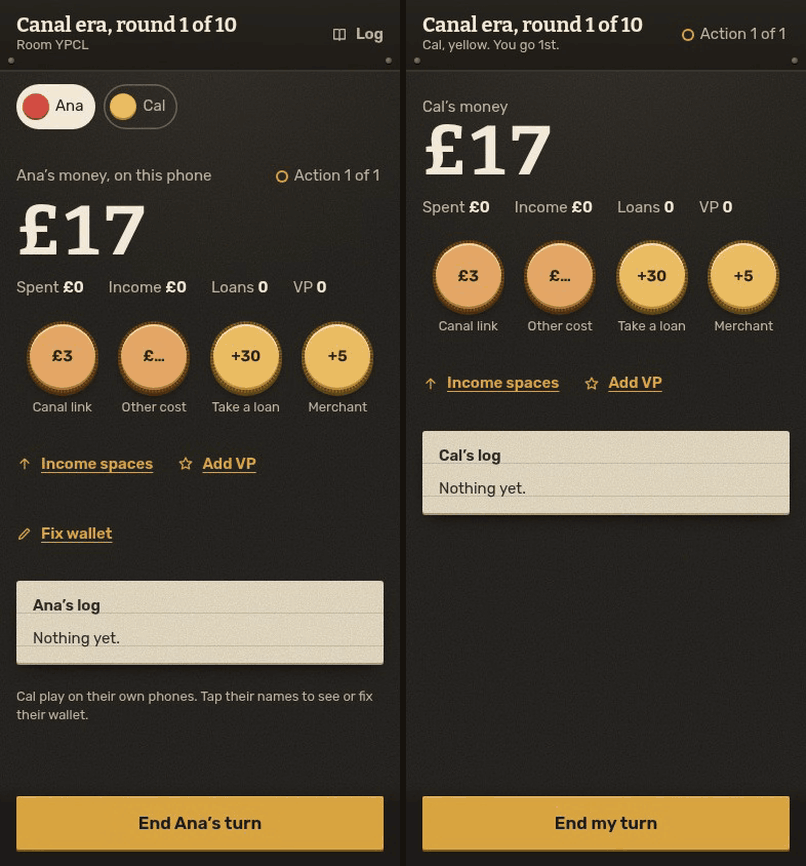
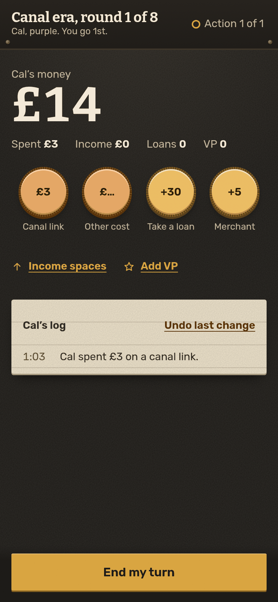
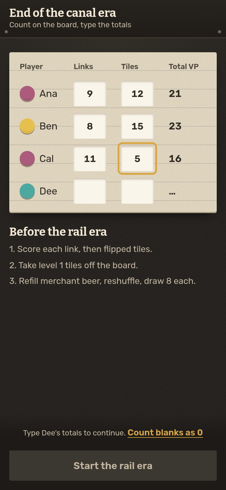
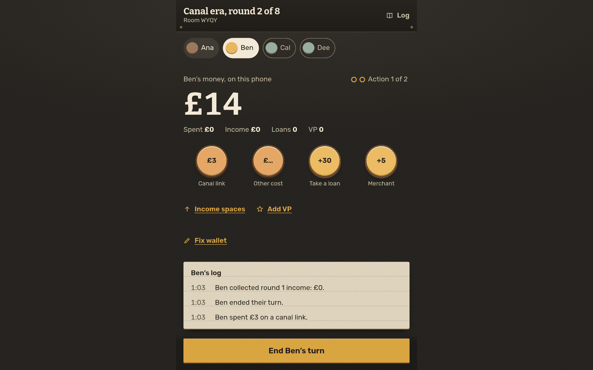

# Brass Wallet

A phone wallet for the board game Brass: Birmingham. It replaces the paper money, income and score bookkeeping, while the board stays on the table.

**Play it: [brass.hatethespurs.com](https://brass.hatethespurs.com)**
[](https://brass.hatethespurs.com)


<p align="center">
  
</p>

## Features
- **One table, any mix of phones.** The host starts a table with a four-letter room code and a QR code. Each seat plays on the host phone or on its own phone.
- **Offline pass-and-play.** With no room, the whole table runs on one phone and is saved locally, so you can resume it later.
- **Round bookkeeping.** Money, spending this round, income, VP, loans and actions for 2 to 4 players. The app works out the next turn order from spending and pays income.
- **Era scoring.** Players type their link and tile VP from the board, and the app adds up the canal and rail era totals.
- **Host fixes and undo.** The host can fix any seat or undo a change. Every fix records who made it and shows in that player's log.
- **Seat takeover.** The host phone can take over the seat of a player whose phone dropped.
- **Fast reconnect.** A phone that wakes or comes back online reconnects at once.
- **Changes apply once.** A tap that arrives twice, for example after a reconnect, changes the wallet only once.

## Stack
- JavaScript (ES modules), vanilla HTML and CSS, no framework and no client build step.
- Cloudflare Worker with SQLite-backed Durable Objects and the WebSocket Hibernation API. Workers Static Assets serves the client.
- PWA: web app manifest and a service worker (cache-first static files, network-first pages, `/api` and `/ws` never cached).
- Self-hosted, subset fonts (Bitter and Rubik). Built-in QR encoder.
- Tooling: Wrangler 4, Node's built-in test runner, Playwright with Chromium for the browser e2e.

## Run locally
Requires Node 22 or later (Wrangler 4 needs it).
```sh
npm ci
npm run dev        # wrangler dev on http://localhost:8787
```

## Tests
```sh
npm test           # 54 tests across 9 files
```
`npm test` runs `node --test` over `test/*.test.js`. It covers the rules and reducer, simulated 2, 3 and 4 player games, shared game invariants, duplicate messages, reconnect, safe areas, font subsets, required files and a copy lint.

The browser e2e drives a host phone, two connected phones and one local seat through both eras, with reconnects, a host refresh, fixes, offline play and layout checks at three screen sizes. It needs `playwright-core` and Chrome or Chromium:
```sh
npm i --no-save playwright-core
PW=$PWD/node_modules/playwright-core CHROME=/path/to/chrome npm run e2e
```
Without `BASE` it starts `wrangler dev` itself. Set `BASE=http://127.0.0.1:<port>` to use a server that is already running.

## Project structure
```
src/worker.js          Worker: /api/create, /api/room/:code, /ws/:code, static assets; the Room Durable Object
public/js/table.js     pure game reducer and per-viewer projection; no DOM, no network
public/js/room.js      socket identity (host key or seat token) and handshake
public/js/rules.js     every number and default, pinned per table with RULES_VERSION
public/js/app.js       the client; runs table.js locally or talks to the Room
public/sw.js           service worker
test/                  node:test suites and the shared test kit
test/e2e/              multi-phone browser tests (Playwright)
scripts/               test gate, single-file build, font subsetting
wrangler.jsonc         Worker, assets and Durable Object config
```
Each table is one `Room` Durable Object, addressed by its room code. The Room checks each message, runs it through the same reducer the phone uses offline, saves the result and sends every socket its own view, with host keys and seat tokens removed. Messages carry an ID so a repeated change is ignored, and rooms expire 24 hours after their last change.

The mapping from income spaces to income levels (`INCOME_TRACK` in `public/js/rules.js`) is a default that still needs checking against the board.

## Deploying
`npx wrangler deploy` uploads the Worker, the assets in `public/` and the `Room` Durable Object. Do not rename the `Room` class or edit the `v1` migration, because live tables are stored in it. After changing anything in `public/`, restamp the service worker version so phones get the new files. `npm run build` writes a single-file `dist-embedded/worker.js` with every asset inlined.

## More screenshots
<p>
  
  
  
</p>

## Credits
- Brass: Birmingham is published by Roxley. This is an unofficial companion app. It uses no Roxley art and copies no rules text. Numbers come from the Roxley rulebook v2018.11.
- Fonts: [Bitter](https://github.com/solmatas/BitterPro) and [Rubik](https://github.com/googlefonts/rubik), under the SIL Open Font License 1.1 (see `public/fonts/`).
